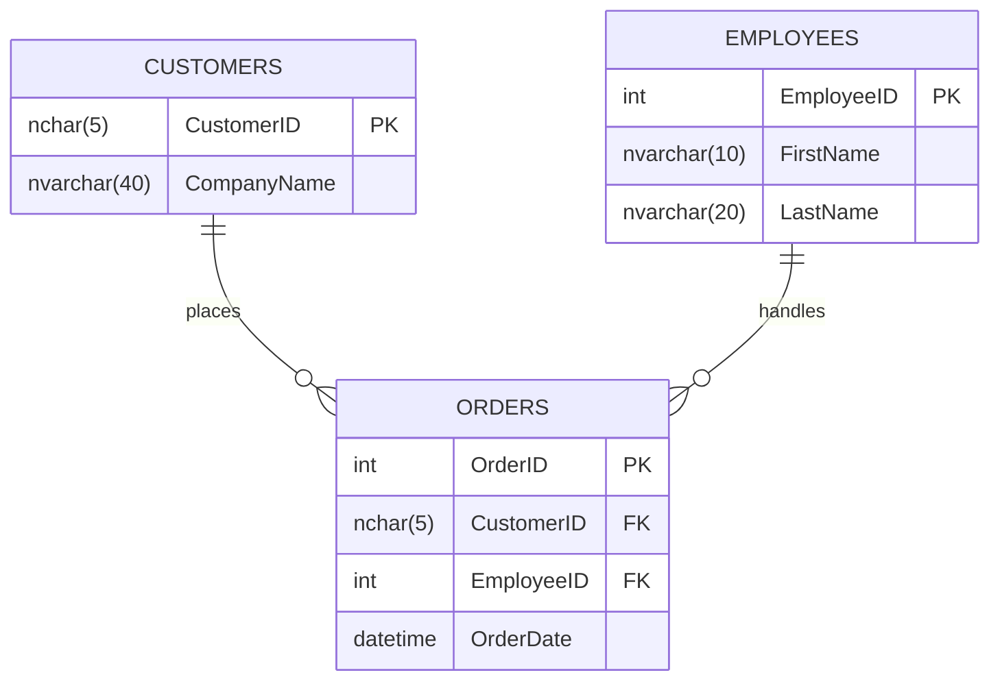

1. Create an Entity-Relationship Diagram (ERD) showing entities, attributes, and relationships.
You may:
Hand-draw the ERD and take a clear photo.
OR use a digital tool (e.g., Figma, Canva, draw.io) and take a screenshot.

2. Save the image and place it in your “Task 4” folder.

3. SQL Schema (reference Northwind Database; same database used in Geek Week)
Write CREATE TABLE statements for at least three entities, including:
Primary keys (PK)
Foreign keys (FK)
Appropriate data types and NOT NULL constraints.

Please add your SQL query below AND add an explanation:

```sql
CREATE TABLE Customers (
    CustomerID   NCHAR(5)      NOT NULL PRIMARY KEY,
    CompanyName  NVARCHAR(40)  NOT NULL
);

CREATE TABLE Employees (
    EmployeeID  INT           NOT NULL PRIMARY KEY,
    FirstName   NVARCHAR(10)  NOT NULL,
    LastName    NVARCHAR(20)  NOT NULL
);

CREATE TABLE Orders (
    OrderID     INT       NOT NULL PRIMARY KEY,
    CustomerID  NCHAR(5)  NOT NULL FOREIGN KEY REFERENCES Customers(CustomerID),
    EmployeeID  INT       NOT NULL FOREIGN KEY REFERENCES Employees(EmployeeID),
    OrderDate   DATETIME  NOT NULL
);
```

**Explanation**

Three tables from Northwind: Customers, Employees, and Orders. Each has a primary key that uniquely identifies every row. Orders has two foreign keys linking each order to the customer who placed it and the employee who handled it. Data types fit the data (INT for IDs, NVARCHAR for text, DATETIME for dates), and NOT NULL makes every column required.

4. For submission, commit and push.

## ERD


